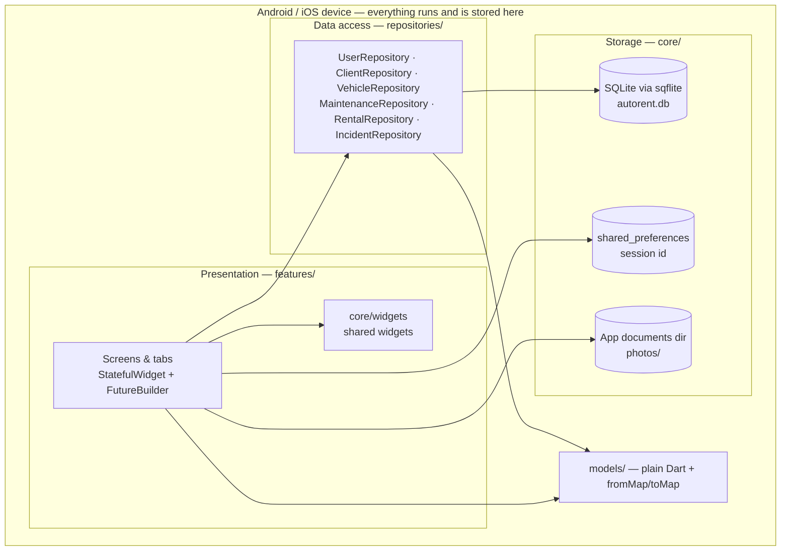
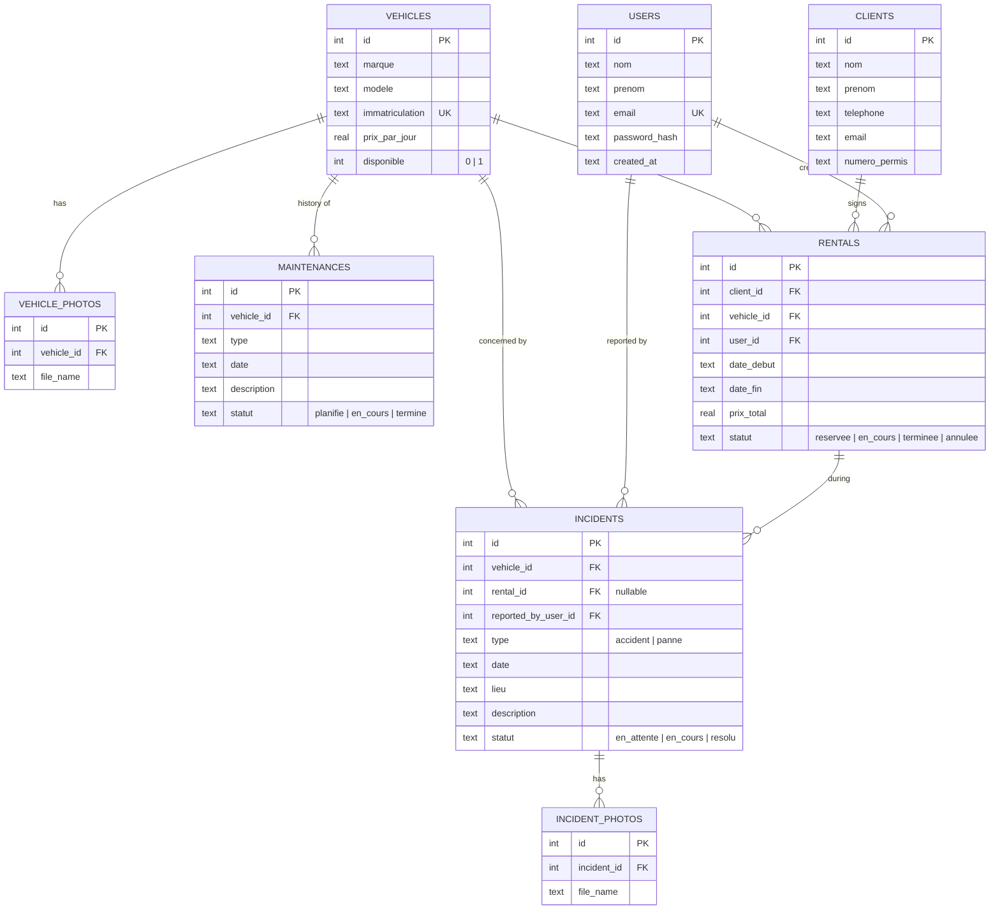
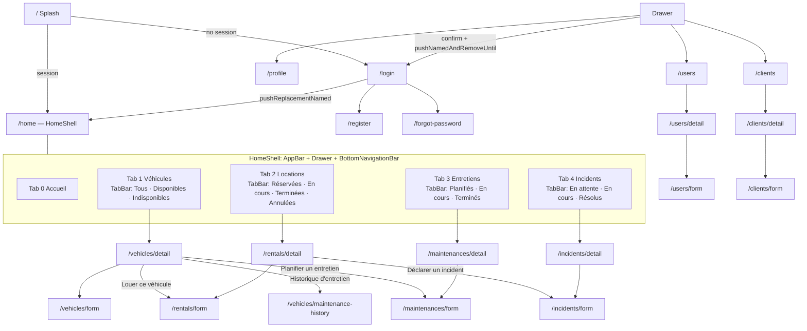
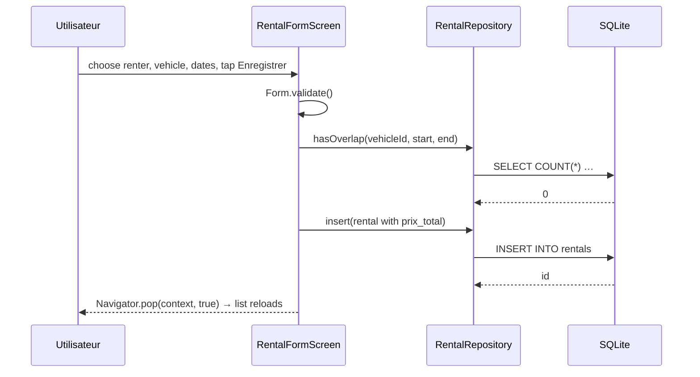

# Diagrams to copy into docs/ARCHITECTURE.md

Adjust names only if the generated code differs.

## 1. Layers (offline, no server)

## 2. Entity-relationship model

## 3. Navigation graph

## 4. Typical call flow (create a rental)

