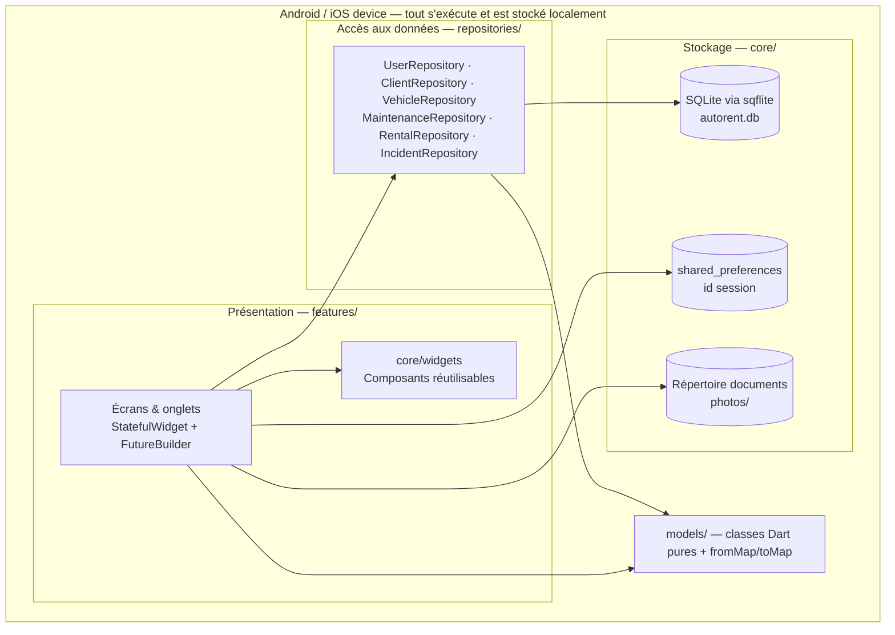
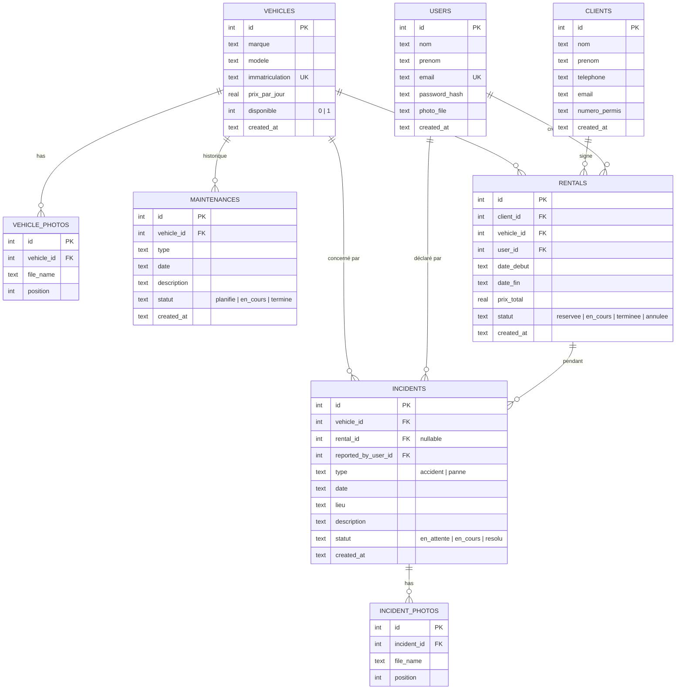
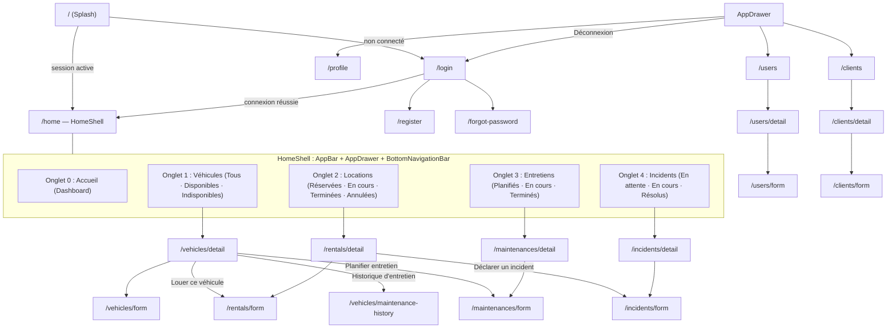

# Architecture de l'application AutoRent

AutoRent est une application Flutter autonome (100% hors-ligne) pour la gestion d'une agence de location de véhicules, conçue dans le cadre du cours de développement mobile à ESPRIT.

---

## 1. Vue d'ensemble & Principes directeurs

- **100% Hors-ligne / Aucune API serveur :** Toutes les données opérationnelles sont stockées en local sur le terminal (SQLite avec `sqflite`). Les préférences et identifiants de session sont conservés dans `shared_preferences`. Les images sont enregistrées dans le répertoire des documents de l'application (`path_provider`).
- **Périmètre du cours :** Utilisation stricte des composants fondamentaux de Flutter (`StatefulWidget`, `setState`, `FutureBuilder`, Navigator 1.0 avec routes nommées et arguments typés). Aucune bibliothèque d'état externe complexe (Provider, Riverpod, Bloc, etc.).
- **Authentification sans rôles :** Un seul profil d'utilisateur (« Agent de location »). Tout utilisateur connecté accède à la totalité des fonctionnalités de l'application sans distinction administrative ni restriction par rôles.

---

## 2. Diagramme des couches (Layers)

---

## 3. Schéma Entité-Association (ERD)

---

## 4. Graphe de Navigation

---

## 5. Description des couches

### Présentation (`lib/features/`)
- Contient les écrans et onglets organisés par module métier (`auth`, `home`, `vehicles`, `rentals`, `maintenances`, `incidents`, `clients`, `users`, `profile`).
- Chaque écran est relié aux repositories, reçoit ses paramètres via son constructeur (déballés par `AppRouter`) et retourne un résultat booléen (`true` en cas de modification/suppression) pour rafraîchir la vue appelante.

### Couche d'accès aux données (`lib/repositories/`)
- Encapsule l'ensemble des requêtes SQL SQLite (`SELECT`, `INSERT`, `UPDATE`, `DELETE`) et les transactions ACID.
- Valide les règles métier critiques (unicité des immatriculations/emails, chevauchement de dates pour les locations, vérification d'intégrité référentielle avant suppression).
- Lève des `AppException` avec des messages clairs en français en cas de conflit ou de violation de contrainte.

### Couche Modèles (`lib/models/`)
- Objets métiers immuables (`User`, `Client`, `Vehicle`, `Maintenance`, `Rental`, `Incident`) et leurs vues de jointure (`RentalView`, `MaintenanceView`, `IncidentView`).
- Gère la sérialisation bidirectionnelle : noms de colonnes SQL snake_case en français vers champs Dart camelCase en anglais.

### Services & Utilitaires transverses (`lib/core/`)
- `DatabaseHelper` : Singleton SQLite orchestrant les schémas DDL, clés étrangères et le jeu de données initial (seeding).
- `SessionManager` : Gestion de la persistance de la session locale via `SharedPreferences`.
- `PasswordHasher` : Hachage sécurisé des mots de passe en SHA-256 avec sel aléatoire.
- `ImageStorage` : Enregistrement et résolution locale des photos dans l'espace de stockage de l'appareil.
- `Strings` : Centralisation des chaînes de caractères de l'interface en français.
